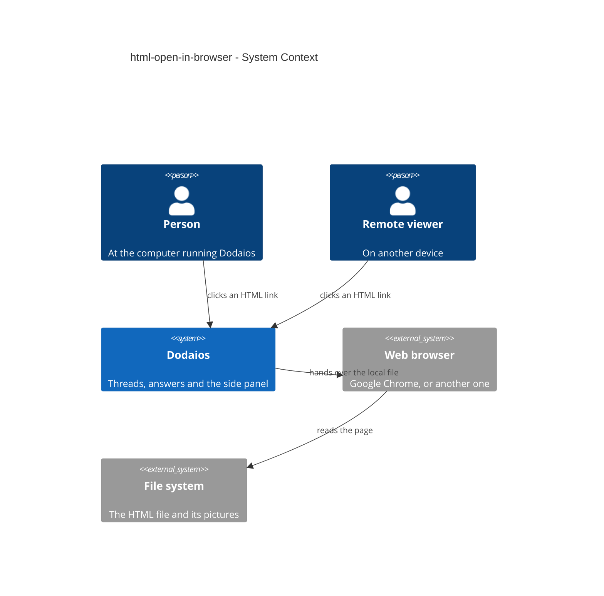
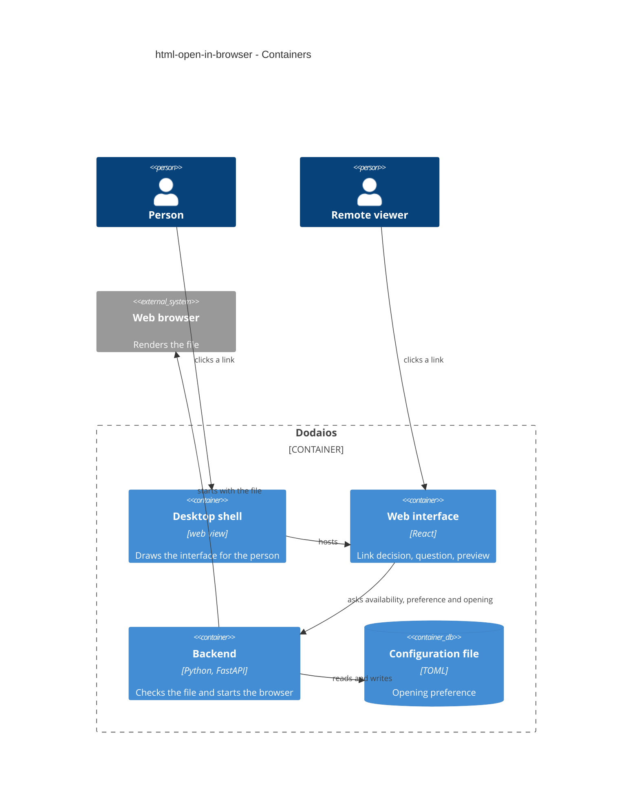
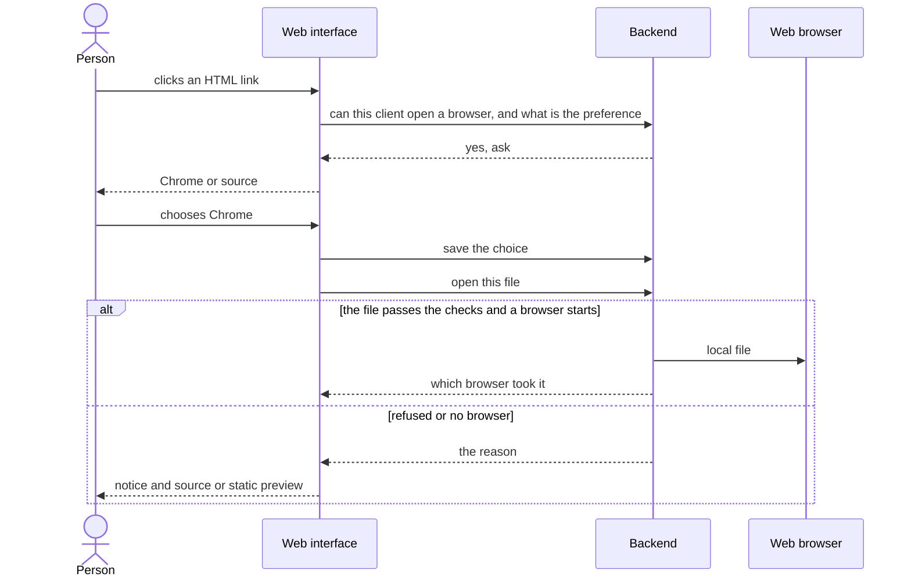

# Software Architecture Document — html-open-in-browser

## 1. Introduction and goals

**Intent.** A click on an HTML link in a thread's answer shows the page instead of its markup: a person on the computer running Dodaios gets it in Google Chrome once they chose so, a remote viewer gets a static preview, and the source stays reachable.

**Top-3 quality goals:**

1. Safety: nothing opens without the person's click, and only a real local HTML file reaches a browser.
2. Honesty: every click has a visible result on every supported operating system.
3. Speed: the page is handed to the browser without a noticeable wait.

**Stakeholders.**

| Role | Interest | Sign-off owner? |
|---|---|---|
| person | reads the pages agents make | Yes (GVRO) |
| remote viewer | reads the same pages from another device | No |
| Tech Lead | design approval | Yes |

Decisions in this document were taken by the agent at the "easy" depth the owner chose, and are open to veto.

## 2. Constraints

**Technical.**
- Python backend with FastAPI routes; React 18, Vite, Zustand and Tailwind frontend shown in a desktop web view or a browser.
- The desktop web view cannot open browser tabs itself; the backend has to start the browser.
- The existing web opener accepts web addresses only, on purpose.
- Windows, macOS and Linux, including a server with no screen.

**Organisational.**
- Ships in the owner's fork only. The architecture map covers conversation continuity, not this area, so the code was read directly at commit `162478613`.

**Conventions.**
- `AGENTS.md`: configuration is written only through the config writer; every subprocess passes the no-window flag; no swallowed exceptions; no config field that nothing reads; every locale is equal.

**Regulatory / external.**
- N/A: nothing leaves the computer.

## 3. Context and scope

The thread timeline already turns file references in answers into clicks that open the side panel. This feature changes only what a click on an HTML link does.

| Actor or system | Type | Interaction |
|---|---|---|
| person | Person | clicks an HTML link, chooses how it opens |
| remote viewer | Person | clicks the same link from another device |
| web browser | System (external) | renders the local file |
| file system | System (external) | holds the HTML file and what it refers to |



## 4. Solution strategy

1. **Surfaces.** The backend, the web interface and the desktop shell, which draws that same interface. No new interface technology: the existing React app and its stores.
2. **Open the file itself from disk** in a real browser started by the backend, so the page behaves as when opened from its folder (ADR-0001).
3. **One narrow action for HTML pages**, with the same locality and path checks as opening a terminal path, instead of loosening the web opener or the general "open on this computer" action (ADR-0002).
4. **Decide in one place in the interface.** The thread already sends every file reference through one function; HTML links without a line number branch there.
5. **The preference lives in the app configuration**, like the colour theme, so it survives restarts and a cleared web view store.

## 5. Building block view

The change extends existing layers; it adds no new service or datastore.

```
dodaios/
├── core/config.py              ui.html_link_open: ask | browser | source
├── core/config_writer.py       writer for that value
├── platform/open_path.py       HTML file check; Chrome first, then another browser
└── ui/web/
    ├── settings_routes.py      read and change the preference
    ├── agentic_ide_html_routes.py   (new) availability and open
    └── frontend/src/
        ├── components/agentic/threads/openHtmlLink.ts   (new) the click decision
        ├── components/agentic/threads/openPathBeside.ts path lookup shared with it
        ├── components/agentic/threads/HtmlOpenDialog.tsx (new) the first-click question
        ├── components/agentic/sidePanel/file/FileTab.tsx static preview next to source
        └── settings and context menu                    preference control, secondary action
```



**What the click does, in order:**

1. A link with a line number opens the source at that line.
2. Otherwise the file is found with the thread's existing lookup. Not found: the side panel says so, and nothing else happens.
3. If this client cannot open a browser here, the side panel shows the static preview with the source one tab away.
4. Preference "ask": show the question, naming the file and folder and saying that scripts will run. Closing it ends the click; a choice is saved first.
5. "source" opens the side panel. "browser" calls the open action; a repeat of the same file within 1 second is ignored.
6. The answer says which browser took it. Not Chrome: a notice. None: a notice and the static preview. Refused as a network file: the source and the reason.

The secondary action on a link runs step 5 with the other view and saves nothing.

**Static preview.** The frame runs no scripts and gets a content policy that blocks every network request; a banner says the preview is partial.

**Browser choice per system.**

| System | First | Then |
|---|---|---|
| Windows | Chrome from its install locations | the default web browser's program, then other known browsers |
| macOS | Google Chrome by application name | other known browsers by application name |
| Linux | Chrome or Chromium on the path | the desktop's default web browser, then other known browsers |

The system's association for HTML files is never followed: it can be an editor.

## 6. Runtime view



## 7. Deployment view

<!-- N/A: reuses the existing backend and frontend bundle, no infrastructure change -->

## 8. Crosscutting concepts

| Concept | Convention | Where defined |
|---|---|---|
| Logging | log the outcome and the browser used, not the file's full path | here |
| Authorization | loopback client and host, plus native file actions enabled | existing terminal-path opening |
| Error handling | the backend returns a reason code; the interface words it | here |
| Internationalisation | every new text in all five locale catalogs | `AGENTS.md` |
| Process launching | argument list, no shell, no-window flag | `AGENTS.md` |

## 9. Architecture decisions

| # | Title | Status | Section |
|---|---|---|---|
| 0001 | Open the linked file from disk in a real browser | Accepted | §4 |
| 0002 | Add a narrow action that opens only HTML pages | Accepted | §4 |

## 10. Quality requirements

**QG-1. Safety**
- **When:** an answer arrives, a link is hovered, or a request comes from another device.
- **Then:** nothing opens; only a local regular file ending in .html or .htm, after links in the file system are followed, reaches a browser.
- **How verify:** route tests for a remote client, a disguised program, a network file and a symbolic link; interface test that rendering an answer calls nothing.

**QG-2. Honesty**
- **When:** a click on an HTML link, on Windows, macOS, Linux or a server with no screen.
- **Then:** "3 of 3" platforms cover the criteria, with "0 crashes and 0 attempts to open a browser on the server".
- **How verify:** one test per platform branch, the remote-client test, one manual run on Windows.

**QG-3. Speed and persistence**
- **When:** a click with the preference set, and after a restart.
- **Then:** "≤ 1000 ms" p95 to hand the page to the browser; "100% kept across restarts".
- **How verify:** timed over 20 clicks; config round-trip test.

## 11. Risks and technical debt

| Risk / debt | Severity | Mitigation | Owner |
|---|---|---|---|
| A page's scripts run in the person's own browser profile | Medium | the first question says so; only their click opens; accepted by the owner for files outside the project too | GVRO |
| On macOS the fallback without Chrome follows a fixed list, which may not be the default browser | Low | say which browser took the page; refine if reported | Tech Lead |
| A page that refers to files by relative path stays broken in the static preview | Low | the banner says the preview is partial | Tech Lead |
| Only Windows can be run by hand here | Medium | platform branches covered by tests | Tech Lead |

**Accepted debt:**
- The terminal, file tree and code editor keep their current HTML behaviour.

## 12. Glossary

See [CONTEXT](./CONTEXT.md): HTML link, opening preference, person, remote viewer, rendered page, source view, static preview.
