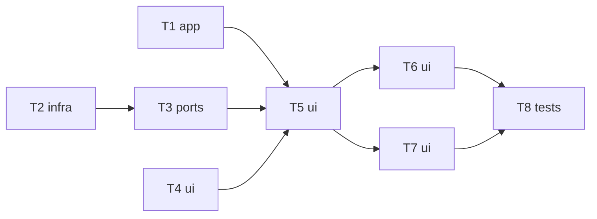

# Epic — html-open-in-browser

> **Spec:** [spec.md](../spec.md) · **Design:** [sad.md](../sad.md) · **ADRs:** [adr/](../adr/)

## Goal

A click on an HTML link shows the page in a browser once the person chose so, with the source still reachable and a static preview where no browser can be opened.

## Scope

- **In:** the preference, the file check and launcher, two routes, the thread's link handling, the side panel preview, Settings.
- **Out:** file tree, editor, terminal, work log, other file types, web links.

## Task map

## Tasks

See [tracker.md](./tracker.md) for status. Machine contract: [tasks.json](../tasks.json).

| # | Task | Layer | Blocked by | DoD (short) |
|---|---|---|---|---|
| T1 | Store and expose the HTML opening preference | app | — | Round-trip tests show the value survives a reload and an unknown value is rejected. |
| T2 | Check an HTML file and start a browser on it | infra | — | Tests pass for the three system branches, the refusals and the no-display case. |
| T3 | Add the availability and open routes for HTML pages | ports | T2 | Route tests prove a remote or headless client starts nothing and each reason code is returned. |
| T4 | Show a static preview of HTML in the side panel | ui | — | Component tests show no scripts, the blocking policy, the banner and the source tab. |
| T5 | Route an HTML link click by preference and result | ui | T1, T3, T4 | Unit tests cover every branch, including that rendering an answer calls nothing. |
| T6 | Ask how to open HTML on the first click | ui | T5 | Component tests cover both choices, dismissal and that no click means no opening. |
| T7 | Add the other-view action and the Settings control | ui | T5 | Tests show the preference unchanged after the secondary action and changed by Settings. |
| T8 | Run the acceptance checks in the Dev app | tests | T6, T7 | A written result per acceptance criterion, stating what was not verified. |

## Risks / Hard rules

- Nothing opens without the person's click; only a real local HTML file reaches a browser.
- Every new text exists in all five locale catalogs.
- Ships in the owner's fork only.
